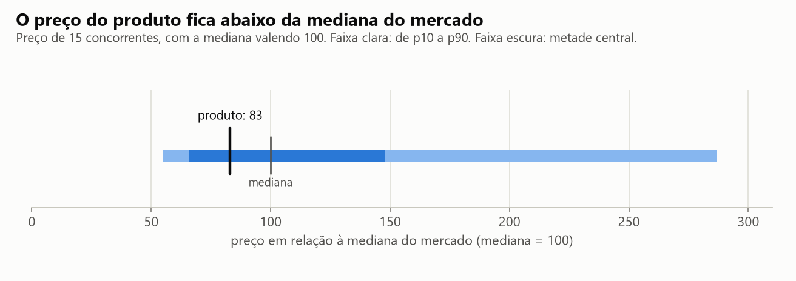
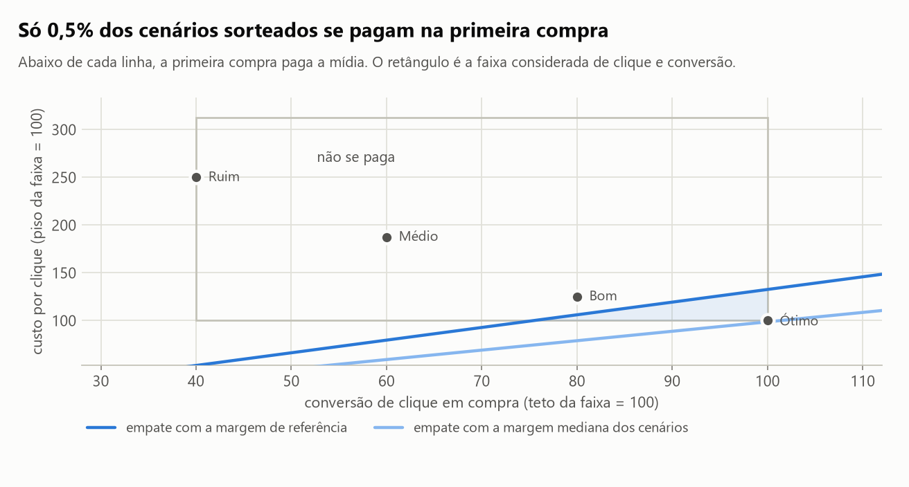
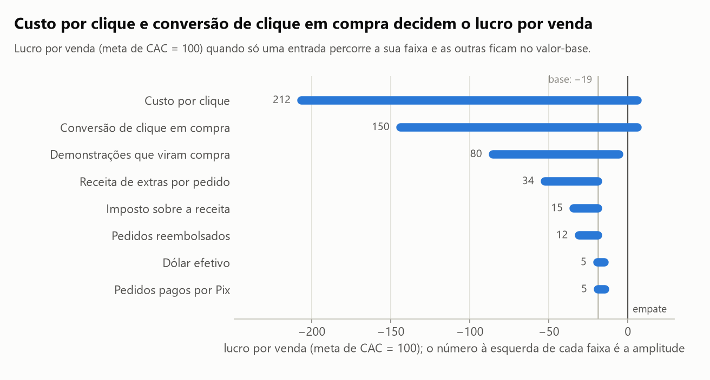
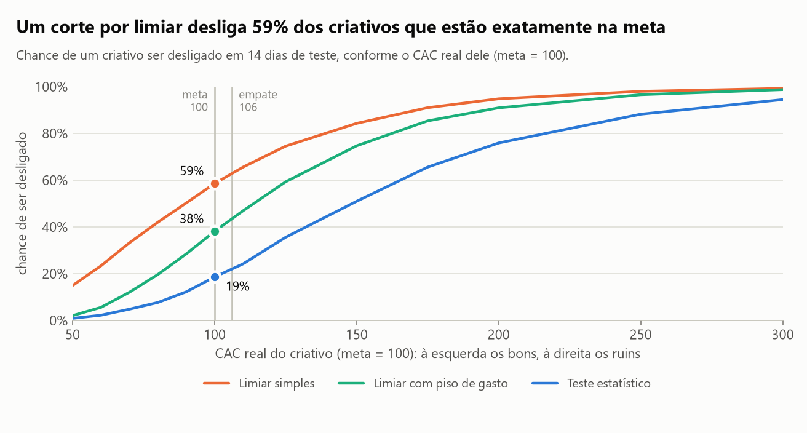
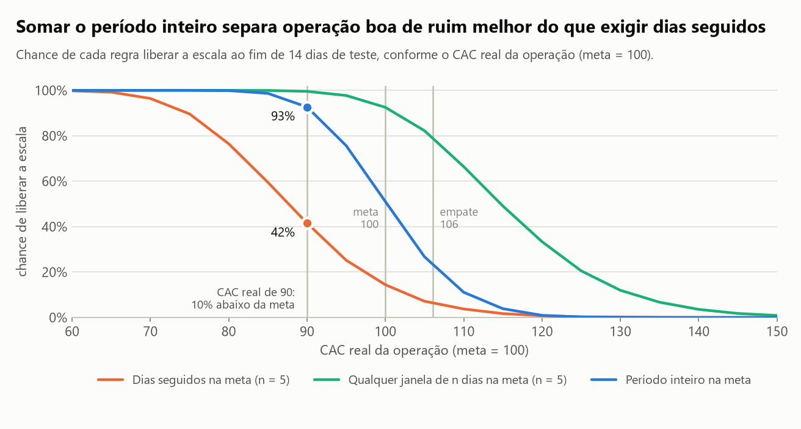

# As regras de verba aguentam o ruído?

Decisão de tráfego pago antes da primeira venda. O estudo nasceu do lançamento de um produto digital meu
e, por isso, é publicado em **unidades relativas**: a meta de CAC vale 100 e todo valor em moeda é lido
contra ela. Preço, custos, verba e os parâmetros do lançamento não estão neste repositório.

Quase toda operação de tráfego tem uma meta de CAC e duas regras de bolso para a verba: desligar o criativo
quando o gasto passa de *k* vezes a meta sem venda (ou quando o CAC passa de *k* vezes a meta), e só escalar
depois de *n* dias seguidos na meta. Este projeto responde a duas perguntas antes de gastar: **a conta
fecha?** e **regras desse formato decidem certo quando os números do dia oscilam por acaso?**

> **English summary.** Paid-traffic decisions before the first sale of a digital product, published in
> relative units (target CAC = 100; no prices, costs or budgets). Unit economics with uncertainty (100k
> sampled scenarios over input ranges), one-at-a-time sensitivity, and the operating characteristics of
> common budget rules under Poisson noise: a threshold kill rule (spend reaches 2x target with no sale, or
> CAC above 1.5x target) switches off 59% of on-target creatives, and an "n days in a row on target" scale
> rule (n = 5) misses a profitable operation 58% of the time, while pooling the whole 14-day test catches
> it 93% of the time. The multipliers and n are swept in a sensitivity grid. Includes a DuckDB SQL metric
> layer (window functions, gaps and islands) cross-checked against the Python rules. There were no
> customers yet: traffic inputs are labeled assumptions.

## Resultados

| Pergunta | Resposta |
|---|---|
| Onde o preço está no mercado? | Abaixo da mediana: 17% abaixo, com 6 concorrentes cobrando menos e 9 cobrando mais |
| Quanto sobra por venda para pagar mídia? | **106**, com a meta de CAC em 100: é o CAC de empate, só 6% acima da meta |
| A conta fecha? | Em **0,5%** dos cenários sorteados. Dos 4 cenários de referência, só o "Ótimo" dá lucro |
| O que medir primeiro? | CPC e conversão: movem o lucro por venda em 212 e 150 pontos. Câmbio e forma de pagamento, 5 pontos |
| Um corte por limiar decide certo? | Desliga **59%** dos criativos que estão na meta. Com piso de gasto, 38% |
| "Dias seguidos na meta" decide certo? | Libera só **42%** das vezes uma operação lucrativa (CAC 10% abaixo da meta). Somando o teste inteiro, 93% |

## Como ler os números

- **Escala.** Todo valor em moeda foi dividido pela meta de CAC e multiplicado por 100. Um CAC de 125 é um
  CAC 25% acima da meta; um lucro por venda de −19 é um prejuízo de 19% da meta em cada venda.
- **O que é relativo por natureza** fica como está: probabilidades, frações de cenários, conversões em
  relação à ponta da faixa, retorno sobre a verba.
- **O que não está no repositório:** preço do produto, custos por venda, taxas, imposto, câmbio aplicado,
  verba, as faixas de cada entrada e os preços individuais dos concorrentes. Esses valores ficam num
  arquivo local fora do git (`data/privado/`). O repositório traz
  [`data/parametros_exemplo.json`](data/parametros_exemplo.json), com valores **fictícios**, para o código
  rodar e os testes passarem.
- **A normalização não muda nenhum resultado.** Um teste multiplica todos os valores em moeda por um
  fator e confere que as tabelas publicadas saem iguais.

## O que é dado real e o que é premissa

| Entrada | Origem |
|---|---|
| Preços de concorrentes | Levantamento próprio; aqui só a posição relativa do preço |
| Custo variável por venda e por demonstração grátis | Medido |
| Câmbio | PTAX diária do Banco Central, 12 meses (`data/cambio_ptax.csv`) |
| Taxas de pagamento e imposto | Publicadas, a confirmar |
| CPC, conversões, receita de extras, reembolso | **Premissa**: o produto ainda não tinha clientes |
| Operação da camada SQL | **Simulada**, com valores fictícios e a verdade conhecida |

## 1. O preço no mercado



Com a mediana do mercado em 100, o preço do produto fica em 83. Seis concorrentes cobram menos e nove
cobram mais (percentil 40). São 15 marcas num único dia: dá para dizer onde o preço está, não qual preço
vende mais.

## 2. A conta fecha?

De cada venda saem taxa de pagamento, imposto, custo de entrega e o custo das **demonstrações grátis que
não viraram compra** (quem compra carrega a conta de quem só experimentou). O que resta é a sobra para
mídia, que é o CAC de empate: 106. A função de margem foi conferida contra duas contas feitas à parte,
com desvio abaixo de 1%.



| Cenário de referência | CAC (meta = 100) | CAC ÷ CAC de empate | Lucro por venda |
|---|---|---|---|
| Ótimo | 80 | 0,75 | +26 |
| Bom | 125 | 1,18 | −19 |
| Médio | 250 | 2,36 | −144 |
| Ruim | 500 | 4,71 | −394 |

Sorteando 100 mil cenários dentro das faixas (todo valor tratado como igualmente plausível), 0,5% se
pagam na primeira compra e 2% ficam com CAC na meta. Esse número não é a probabilidade de o lançamento
dar certo: é o tamanho da aposta. A meta exige clique perto do piso da faixa **e** conversão perto do teto.

## 3. O que medir primeiro



| Entrada | Amplitude no lucro por venda (meta = 100) | Em relação à maior |
|---|---|---|
| Custo por clique | 212 | 100% |
| Conversão de clique em compra | 150 | 71% |
| Demonstrações que viram compra | 80 | 38% |
| Receita de extras por pedido | 34 | 16% |
| Imposto | 15 | 7% |
| Reembolso | 12 | 6% |
| Dólar efetivo | 5 | 2% |
| Pedidos pagos por Pix | 5 | 2% |

Trocar de fornecedor ou negociar taxa de pagamento não muda a decisão. Medir CPC e conversão muda.
E leva tempo: num teste que rende 12,5 vendas por dia na meta, um CAC real de 100 pode aparecer como 78
ou como 134 depois de 3 dias, e ainda entre 89 e 114 depois de 14.

## 4. A regra de corte de criativo

Vendas por dia são contagens que oscilam em torno de gasto ÷ CAC real (Poisson). Cada regra foi simulada
20 mil vezes para cada CAC real, num teste de 14 dias em que um criativo na meta rende 0,83 venda por dia.

Três regras:

- **Limiar simples:** desligar quando o gasto chega a *k* vezes a meta sem venda, ou quando o CAC
  acumulado passa de *k* vezes a meta. Ponto de referência: 2 e 1,5.
- **Limiar com piso de gasto:** a mesma regra, mas o CAC só é julgado depois de o criativo gastar 4 vezes
  a meta.
- **Teste estatístico:** desligar quando vender tão pouco seria improvável (menos de 10%) se o criativo
  estivesse no CAC de empate.



| CAC real do criativo (meta = 100) | Limiar simples | Com piso de gasto | Teste estatístico |
|---|---|---|---|
| 70 (ótimo) | 33% | 12% | 5% |
| 100 (na meta) | 59% | 38% | 19% |
| 200 (ruim) | 95% | 91% | 76% |
| Gasto médio no criativo de CAC 200 | 320 | 499 | 679 |

O limiar simples erra porque julga o CAC cedo demais: um criativo que faz a primeira venda depois de
gastar 170 tem "CAC de 170" e sai, embora uma venda só não diga quase nada. Exigir um piso de gasto
antes de julgar o CAC custa 179 a mais por criativo ruim e salva um terço dos bons.

**Os multiplicadores mudam a conclusão?** Fração de criativos na meta que o limiar simples desliga, para
cada par (em negrito, o ponto de referência):

| Gasto sem venda que desliga ↓ · CAC que desliga → | 1,25 × meta | 1,5 × meta | 2 × meta | 3 × meta |
|---|---|---|---|---|
| 1,5 × meta | 68% | 61% | 39% | 25% |
| 2 × meta | 66% | **59%** | 36% | 18% |
| 3 × meta | 66% | 58% | 35% | 16% |
| 4 × meta | 66% | 58% | 34% | 15% |

Quem manda é o limiar de CAC, não o de gasto sem venda: esperar mais antes de desistir de quem não vendeu
quase não muda o erro, e só um limiar de CAC bem folgado o reduz. O piso de gasto ataca a causa:

| Piso de gasto antes de julgar o CAC | Desliga criativo na meta | Desliga criativo com o dobro da meta | Gasto médio no criativo com o dobro da meta |
|---|---|---|---|
| sem piso | 59% | 95% | 320 |
| 2 × meta | 48% | 93% | 389 |
| 4 × meta | 38% | 91% | 499 |
| 6 × meta | 31% | 89% | 634 |
| 8 × meta | 27% | 87% | 723 |

## 5. A regra de escala



A mesma simulação para a conta inteira, num teste de 14 dias que rende 12,5 vendas por dia na meta.
O retorno é o lucro de escalar dividido pela verba de mídia.

| CAC real (meta = 100) | Retorno sobre a verba de escala | *n* dias seguidos na meta (*n* = 5) | Qualquer janela de *n* dias | Período inteiro |
|---|---|---|---|---|
| 80 | +33% | 76% | 100% | 100% |
| 90 | +18% | 42% | 100% | 93% |
| 100 | +6% | 14% | 93% | 51% |
| 110 | −4% | 4% | 66% | 11% |
| 120 | −12% | 1% | 33% | 1% |
| 130 | −18% | 0% | 12% | 0% |

Exigir dias seguidos é seguro e perde operação boa: um dia ruim zera a contagem e os outros dias são
descartados. "Qualquer janela" é permissiva demais, porque há dez janelas e basta uma dar sorte. Somar
o período inteiro e olhar uma vez só é a regra mais nítida. Um teste formal de Poisson a 10% equivale a
exigir CAC acumulado de até 96 em 14 dias, ou 92 em 7.

**E com outro *n*?** Chance de liberar uma operação boa (CAC 90) e uma ruim (CAC 110):

| *n* | Dias seguidos: libera a boa | Dias seguidos: libera a ruim | Qualquer janela: libera a boa | Qualquer janela: libera a ruim |
|---|---|---|---|---|
| 2 | 99% | 75% | 100% | 98% |
| 3 | 87% | 32% | 100% | 88% |
| 4 | 64% | 11% | 100% | 81% |
| 5 | 42% | 4% | 100% | 66% |
| 6 | 25% | 1% | 99% | 59% |
| 7 | 15% | 0% | 99% | 47% |
| Período inteiro | 93% | 11% | | |

Nenhum *n* resolve: quando a regra dos dias seguidos passa a liberar a operação boa, já libera a ruim.
O período inteiro libera a boa em 93% das vezes com o erro que a regra dos dias seguidos só alcança
com *n* = 4, quando libera a boa em 64%.

Com vendas duas vezes mais irregulares que o Poisson, a ordem entre as regras se mantém e todos os erros
crescem (a regra do período inteiro passa a liberar 19% das vezes a operação de CAC 110). As taxas acima
são o melhor caso.

## 6. Camada de métricas em SQL

Consultas em [`sql/`](sql/), rodadas no DuckDB sobre três tabelas (gasto de mídia, demonstrações e
pagamentos):

| Consulta | O que faz | Técnica |
|---|---|---|
| [`metricas_diarias.sql`](sql/metricas_diarias.sql) | Funil e CAC por dia e criativo | CTEs, `LEFT JOIN`, `FILTER` |
| [`corte_criativos.sql`](sql/corte_criativos.sql) | Primeiro dia em que cada regra de corte dispara | Soma acumulada com janela |
| [`escala_dias_seguidos.sql`](sql/escala_dias_seguidos.sql) | Dias seguidos na meta e CAC acumulado | Ilhas e lacunas com `ROW_NUMBER` |
| [`margem_por_criativo.sql`](sql/margem_por_criativo.sql) | Resultado por criativo, com demonstrações perdidas | Agregação condicional |

Rodam sobre uma operação simulada de 14 dias e 9 criativos, com valores fictícios e CAC real conhecido.
Os testes conferem que o SQL e as regras em Python chegam à mesma decisão. No sorteio do notebook, o
melhor criativo da conta (CAC real de 70) é desligado no segundo dia pelo limiar simples, e um de 160
sobrevive ao teste inteiro.

## Limitações

- **Nenhuma venda real.** CPC, conversões, extras e reembolso são premissas, e os resultados das seções 2
  e 3 dependem das faixas escolhidas.
- **Só a primeira compra.** Não entram recompra, indicação, tráfego orgânico nem recuperação de quem
  deixou contato e não comprou. Tudo isso melhora a conta e nada disso tem dado ainda.
- **Sorteio uniforme** dentro das faixas: é a escolha de quem não tem dado. Com uma semana de operação as
  faixas encolhem e a análise deve ser refeita.
- **Vendas como Poisson.** As taxas de erro das regras são o melhor caso.
- **Momento da conferência.** As regras de corte são conferidas ao fim de cada dia, desde a primeira
  venda. Conferir com outra frequência muda as taxas.
- **O tamanho do teste importa.** As taxas valem para um teste de 14 dias com 0,83 venda esperada por dia
  e por criativo na meta. Com mais volume por criativo, todas as regras erram menos.
- **Unidades relativas.** Os números publicados foram gerados com os parâmetros reais, que não estão aqui.
  Com o arquivo de exemplo o código roda de ponta a ponta, mas os valores são outros.
- **Imposto e taxas a confirmar.**

## Como rodar

Pré-requisito: [`uv`](https://docs.astral.sh/uv/getting-started/installation/).

```bash
uv sync
uv run pytest                            # 32 testes
uv run python scripts/rodar_analise.py   # roda a análise inteira
uv run python scripts/extrair_dados.py   # opcional: atualiza o câmbio no Banco Central
```

`rodar_analise.py` procura `data/privado/parametros.json`. Se existir, regera `reports/resultados.json`
e as figuras publicadas. Se não existir (é o caso de um clone), avisa, usa
`data/parametros_exemplo.json` e grava em `reports/exemplo/`, sem tocar nos resultados publicados.
Para usar os seus números, copie o arquivo de exemplo para `data/privado/parametros.json` e edite.

O notebook [`analise.ipynb`](analise.ipynb) conta a história completa.

## Estrutura

```text
├── analise.ipynb
├── data/
│   ├── cambio_ptax.csv          # cotação pública do dólar
│   ├── parametros_exemplo.json  # valores fictícios
│   └── concorrentes_exemplo.csv # preços fictícios
├── sql/                         # as quatro consultas
├── src/trafego_decisao/
│   ├── parametros.py            # lê os parâmetros e converte para a escala publicada
│   ├── economia.py              # margem por venda, sorteio de cenários, sensibilidade
│   ├── regras.py                # regras de corte e de escala sob ruído
│   ├── simulador.py             # operação simulada para a camada SQL
│   ├── consultas.py             # roda o SQL no DuckDB
│   ├── analise.py               # orquestra cada tabela, já em unidades relativas
│   └── graficos.py, estilo.py
├── scripts/                     # rodar_analise.py, extrair_dados.py
├── tests/                       # 32 testes (pytest), com um guarda contra valor em moeda
└── reports/                     # resultados.json e figuras
```

---

Hélcio Venâncio · [github.com/ghitflux](https://github.com/ghitflux) · Licença MIT

## Como este estudo foi feito

Este estudo foi construído com assistência de IA (Claude Code, da Anthropic), usada como par de programação.
Declaro a divisão do trabalho porque ela importa para quem avalia:

- **Meu:** o problema e os dados (a pergunta de negócio, os custos medidos e o levantamento de preços de concorrentes são do meu produto, o Dedico Songs), a leitura crítica dos resultados e a decisão do que publicar e do que declarar como limitação.
- **Com o assistente:** a escolha do método, a implementação do código, dos testes e dos gráficos, e a redação,
  que revisei.
- **Como conferir:** todo número deste README sai de `reports/resultados.json`, gerado por `scripts/rodar_analise.py`; os testes em `tests/` conferem a conta de margem e o SQL contra uma segunda implementação em Python.

É o mesmo jeito que trabalho nos sistemas que entrego: a IA acelera a implementação, e a responsabilidade pelo que
está escrito aqui é minha.

*In English: built with AI assistance (Claude Code) as a pair programmer. Direction, business context, critical
review of the results and the decision of what to publish are mine; method choice, implementation and writing were
done with the assistant and reviewed by me.*
